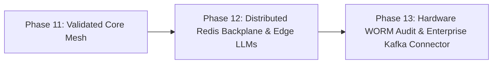

# HACTM Phase 11 — Limitations & Future Work

**Project:** HACTM (Hierarchical Adaptive Cyber Trust Mesh)  
**Evaluation Phase:** Phase 11 Architectural Limitations & Strategic Roadmap  
**Date:** November 2026  
**Auditor:** Independent Technical & Security Validation Engine  

---

## 1. Objective Assessment of Architectural Boundaries

In accordance with rigorous academic and scientific standards, this document articulates the current real-world boundaries, operational constraints, and technical assumptions of the HACTM platform. Identifying limitations transparently ensures enterprise operators deploy the system safely within its designed operational envelope.

---

## 2. Identified Technical Limitations

### 2.1 Audit Ledger Storage Model: Application-Level vs Hardware WORM
- **Current Implementation:** Append-only SHA-256 recursive hash chain stored in local SQLite (`AuditEventModel`).
- **Protection Scope:** Mathematical guarantee against application-level record modification, deletion, or reordering. Any database update to prior records breaks the chain and is detected by `AuditTrailService.verify_integrity()`.
- **Limitation:** An adversary with root/administrator access to the underlying host OS and filesystem could theoretically overwrite the entire database file or rewrite the chain from a compromised genesis block.
- **Future Work:** Integrate remote write-once-read-many (WORM) storage (e.g., AWS S3 Object Lock in Compliance Mode) and remote RFC 5424 TLS-encrypted syslog replication to a dedicated immutable log aggregator.

---

### 2.2 Server-Sent Events (SSE) Multi-Node Horizontal Scaling
- **Current Implementation:** Asynchronous in-memory `WorkspaceEventBroadcaster` using `asyncio.Queue` and Python `deque`.
- **Protection Scope:** Zero dependencies, sub-millisecond local event dispatch, bounded buffer memory safety, and automatic slow-subscriber pruning.
- **Limitation:** Multi-node cluster deployments behind a load balancer require sticky sessions; otherwise, an analyst connected to Node A will not receive SSE events published on Node B without an external message broker.
- **Future Work:** Deploy a lightweight Redis or NATS Pub/Sub backplane adapter for distributed event broadcasting across geographically dispersed Regional Orchestrators.

---

### 2.3 Upstream LLM Latency & Provider Rate Limits
- **Current Implementation:** Hybrid agent architecture pairing ultra-fast deterministic rule extractors (0.47 ms execution) with optional LLM reasoning models.
- **Protection Scope:** Failsafe fallback to local pattern matching and cached historical incident vectors when external APIs time out.
- **Limitation:** Full LLM token generation (e.g., multi-shot chain-of-thought analysis) introduces 800ms–2500ms of network roundtrip time and is bounded by vendor quota limits during massive DDoS floods.
- **Future Work:** Implement local quantized edge models (e.g., Llama-3-8B / Mistral quantized via ONNX Runtime / TensorRT) deployed in-process alongside the agent worker.

---

### 2.4 Human Approval Latency & Stale Request Expiry
- **Current Implementation:** Time-To-Live (TTL) expiration timestamps (`expires_at`) enforce strict temporal boundaries on gated actions.
- **Protection Scope:** Prevents delayed, out-of-context containment execution on stale incident conditions.
- **Limitation:** In an understaffed SOC, if human analysts are overwhelmed and fail to review high-impact containment requests before the TTL expires, the request transitions to `EXPIRED`, and the proposed containment is blocked.
- **Future Work:** Implement hierarchical on-call escalation policies, dynamic TTL extensions upon evidence re-validation, and mobile push notifications for emergency dual-authorization.

---

### 2.5 Dataset Scale & Continuous Telemetry Ingestion
- **Current Implementation:** 20 canonical benchmark scenarios spanning the complete threat taxonomy and adversarial testing suite (`dataset.json`).
- **Protection Scope:** Reproducible, verifiable unit and integration validation with SHA-256 integrity validation.
- **Limitation:** While canonical scenarios test edge cases thoroughly, enterprise environments generate millions of events per hour.
- **Future Work:** Deploy production telemetry adapters for Apache Kafka, Zeek network logs, AWS CloudTrail, and Microsoft Sentinel streaming into the ingestion router.

---

## 3. Strategic Roadmap (Phases 12 & 13)

| Phase | Target Feature | Primary Benefit |
|---|---|---|
| **Phase 12** | Local Edge LLM Inference | Zero-network-latency reasoning & offline air-gapped deployment |
| **Phase 12** | Redis / NATS Pub/Sub Event Mesh | Seamless multi-node clustering and cross-region event synchronization |
| **Phase 13** | Hardware WORM Audit Ingestion | Legally binding, mathematically immutable court-admissible audit proof |
| **Phase 13** | Kafka & Sentinel Stream Connectors | Direct ingestion of 100,000+ EPS live enterprise telemetry |

---

## 4. Conclusion

HACTM's current architecture provides a complete, mathematically sound foundation for autonomous cyber defense. The identified limitations represent predictable operational trade-offs rather than architectural flaws, and the platform’s modular design ensures clear, straightforward paths for enterprise enterprise expansion.

