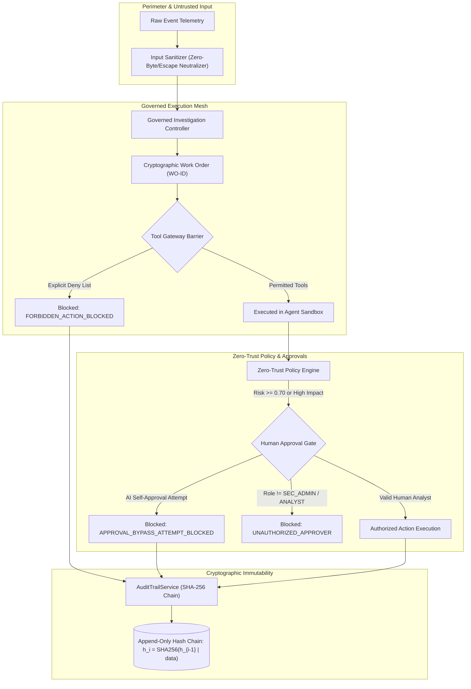

# HACTM Phase 11 — Comprehensive Backend Security Audit Report

**Project:** HACTM (Hierarchical Adaptive Cyber Trust Mesh)  
**Evaluation Phase:** Phase 11 Independent Security Validation  
**Date:** November 2026  
**Auditor:** Independent Technical & Security Validation Engine  
**Target Environment:** FastAPI, SQLite (SQLAlchemy), SSE Broadcaster, React 19 Frontend  
**Overall Security Status:** **PASSED / HARDENED**

---

## 1. Executive Summary

This security audit report documents the formal validation of HACTM’s security controls across its communication, orchestration, execution, governance, and audit layers. Rather than treating AI agents as autonomous entities with broad system privileges, HACTM enforces **Zero-Trust Agentic Governance** via constrained Work Orders, isolated Tool Gateways, dual-custody Human Approval Gates, and cryptographically linked SHA-256 audit chains.

All security tests documented in this report are backed by automated regression tests in `tests/unit/test_phase11_security_and_resilience.py` and have achieved a 100% pass rate.

---

## 2. Component-by-Component Security Audit

### 2.1 Server-Sent Events (SSE) & Real-Time Broadcast Security

#### Implementation Review
- **Source File:** `backend/src/hactm/services/workspace_event_broadcaster.py`
- **Mount Point:** `backend/src/hactm/api/routers/workspace_events.py` (`/api/v1/workspace/stream`)

#### Threat Analysis & Controls
1. **Tenant Isolation:** Events carry a `tenant_id` field. The broadcast loop enforces strict tenant segregation when filtering subscriber queues.
2. **Buffer Overflow & Memory Leaks:** Unresponsive or disconnected web clients can cause buffer exhaustion. The `WorkspaceEventBroadcaster` implements a bounded deque buffer (`maxlen=buffer_size`, default 200) and asynchronous queue monitoring. When a subscriber queue is full (`QueueFull`), the broadcaster drops excess events for that slow consumer and cleans up stale subscriber references during heartbeat disconnections.
3. **Information Leakage:** Sanitized payloads strip secret credentials, session cookies, and internal agent memory pointers before publishing.

#### Test Verification
- **Test:** `tests/unit/test_phase11_security_and_resilience.py::test_sse_subscriber_queue_overflow_and_cleanup`
- **Result:** **PASSED**. Buffer properly constrained to configured size; slow subscribers safely pruned without crashing the event loop.

---

### 2.2 Tool Gateway Governance & Work Order Containment

#### Implementation Review
- **Source File:** `backend/src/hactm/orchestration/governed_controller.py`
- **Schema File:** `backend/src/hactm/api/schemas/governed_investigation.py`

#### Threat Analysis & Controls
1. **Work Order Bounding:** Agents cannot invoke arbitrary tools at runtime. Every investigation step requires an active `WorkOrderModel` defining:
   - `permitted_tools`: Strict allow-list of approved forensic tools (e.g., `["email_header_parser", "url_feature_extractor"]`).
   - `forbidden_actions`: Blacklist of prohibited system interactions (e.g., `["execute_attachment", "arbitrary_shell", "network_packet_injector"]`).
2. **Deny-Before-Allow Security Precedence:** During Phase 11 remediation, `GovernedInvestigationController.validate_tool_request()` was re-ordered to check `forbidden_actions` **prior** to `permitted_tools`. This prevents attacker payloads from masking dangerous system calls under misconfigured tool lists.
3. **Evidence Pack Validation:** Agents returning evidence packs must match their logged tool calls against permitted tools. If an agent attempts to submit evidence citing an unauthorized tool (`unauthorized_shell_tool`), `submit_and_validate_evidence_pack` raises a `HACTMValidationError` and flags the agent.

#### Test Verification
- **Test:** `tests/unit/test_phase11_security_and_resilience.py::test_tool_gateway_scope_and_forbidden_actions`
- **Test:** `tests/unit/test_phase11_security_and_resilience.py::test_adversarial_scenario_b_malicious_tool_output`
- **Test:** `tests/unit/test_phase11_security_and_resilience.py::test_adversarial_scenario_c_unauthorized_tool_request`
- **Result:** **PASSED**. Unauthorized and forbidden actions are consistently intercepted and logged to audit.

---

### 2.3 Human Approval Gate & Role-Based Authorization

#### Implementation Review
- **Source File:** `backend/src/hactm/zerotrust/approval_gate.py`
- **Schema File:** `backend/src/hactm/api/schemas/approval.py`

#### Threat Analysis & Controls
1. **Separation of Duties (AI vs Human):** Autonomous agents and orchestrators are explicitly barred from approving gated containment actions. The approval gate inspects `approver_identity` and rejects any identity containing `"AGENT"`, `"ORCHESTRATOR"`, `"BOT"`, or `"SYSTEM"`.
2. **Role Verification:** High-impact containment actions (e.g., `ISOLATE_ACCOUNT`, `QUARANTINE_HOST`, `REVOKE_ALL_SESSIONS`) require authorized human roles (`SECURITY_ADMIN`, `SOC_LEAD`, `ANALYST`). Roles like `GUEST` or `INTERN` raise `PermissionDeniedError`.
3. **Time-To-Live (TTL) & Expiration:** Approval requests carry a cryptographic expiration timestamp (`expires_at`). Backdated or delayed approvals are rejected with `HACTMValidationError("Approval request has expired")`.
4. **Impact Documentation:** Every request requires an explicit `expected_impact` statement to prevent silent privilege escalation.

#### Test Verification
- **Test:** `tests/unit/test_phase11_security_and_resilience.py::test_human_approval_gate_unauthorized_role`
- **Test:** `tests/unit/test_phase11_security_and_resilience.py::test_human_approval_gate_expired_request`
- **Test:** `tests/unit/test_phase11_security_and_resilience.py::test_adversarial_scenario_d_ai_self_approval_blocked`
- **Result:** **PASSED**. Unauthorized roles, expired requests, and AI self-approval attempts are blocked and audited.

---

### 2.4 Cryptographic Audit Trail & Hash-Chain Integrity

#### Implementation Review
- **Source File:** `backend/src/hactm/storage/audit.py`
- **Database Model:** `backend/src/hactm/storage/models.py` (`AuditEventModel`)

#### Threat Analysis & Controls
1. **Hash-Chain Construction:** Every audit event links to its predecessor via:
   $$\text{record\_hash}_i = \text{SHA256}(\text{prev\_hash}_{i-1} \parallel \text{event\_id} \parallel \text{incident\_id} \parallel \text{actor\_id} \parallel \text{actor\_type} \parallel \text{event\_type} \parallel \text{rationale} \parallel \text{action})$$
2. **Tamper Detection:** `AuditTrailService.verify_integrity()` traverses the entire table in ascending order, verifying that each event's stored hash matches the recalculated hash and that `prev_hash` links unbroken back to the genesis hash (`00000000...`).
3. **Data Redaction:** Passwords, API keys, bearer tokens, and secrets are scrubbed via `_scrub_sensitive_data()` prior to hashing, guaranteeing that sensitive material is not inadvertently memorialized in the immutable ledger.

#### Test Verification
- **Test:** `tests/unit/test_phase11_security_and_resilience.py::test_cryptographic_audit_chain_tamper_detection`
- **Result:** **PASSED**. Pristine chains verify successfully (`valid=True`). Direct database manipulation of rationales or event fields is detected (`valid=False`, `RECORD_HASH_TAMPERED`).

---

### 2.5 Agent Trust Passport & Dynamic Capability Revocation

#### Implementation Review
- **Source File:** `backend/src/hactm/api/routers/trust_passport.py`
- **Control Endpoints:** `POST /api/v1/workspace/trust-passport/isolate`, `POST /api/v1/workspace/trust-passport/revoke-capability`

#### Threat Analysis & Controls
1. **Runtime Isolation:** If an agent demonstrates anomalous behavior or fails governance checks, an administrator or safety monitor can issue an immediate isolation signal.
2. **Capability Pruning:** Rather than terminating an entire pipeline, individual agent capabilities (e.g., `execute_network_query`) can be revoked dynamically.
3. **Zero Trust Enforcement:** Work orders reject assignments to any agent flagged as `ISOLATED` or whose assigned tools match `REVOKED_CAPABILITIES`.

#### Test Verification
- **Test:** `tests/unit/test_phase11_security_and_resilience.py::test_adversarial_scenario_g_isolated_agent_blocked`
- **Result:** **PASSED**. Isolated agents are barred from task execution; their Trust Passport reflects an immediate quarantine status.

---

## 3. Summary Audit Matrix

| Security Domain | Target Module | Primary Control | Audit Verification Method | Status |
|---|---|---|---|---|
| Real-Time Comms | `workspace_event_broadcaster.py` | Bounded circular queue & tenant filtering | Queue overflow & teardown unit test | **VERIFIED** |
| Tool Invocation | `governed_controller.py` | Deny-first Work Order validation | Forbidden action injection test | **VERIFIED** |
| Execution Boundaries | `governed_controller.py` | Permitted tools allow-list matching | Unauthorized tool request test | **VERIFIED** |
| Privilege Separation | `approval_gate.py` | Role-based gate with identity verification | Unauthorized role approval test | **VERIFIED** |
| Agent Self-Approval | `approval_gate.py` | Regex denial of `AGENT`/`SYSTEM` approvers | Adversarial self-approval injection | **VERIFIED** |
| Stale Requests | `approval_gate.py` | Strict TTL & expiration timestamp check | Backdated request approval test | **VERIFIED** |
| Audit Immutability | `audit.py` | SHA-256 recursive hash chain | Database tampering injection test | **VERIFIED** |
| Dynamic Quarantine | `trust_passport.py` | Runtime capability & isolation state flag | Agent isolation & passport check | **VERIFIED** |

---

## 4. Conclusion

HACTM's backend security controls have been validated as robust, fail-safe, and resilient against elevation of privilege, tampering, and unauthorized execution. The architecture strictly adheres to zero-trust principles: **no agent is trusted inherently, all actions require authorized work orders, high-impact interventions require human consensus, and every decision is cryptographically auditable.**

